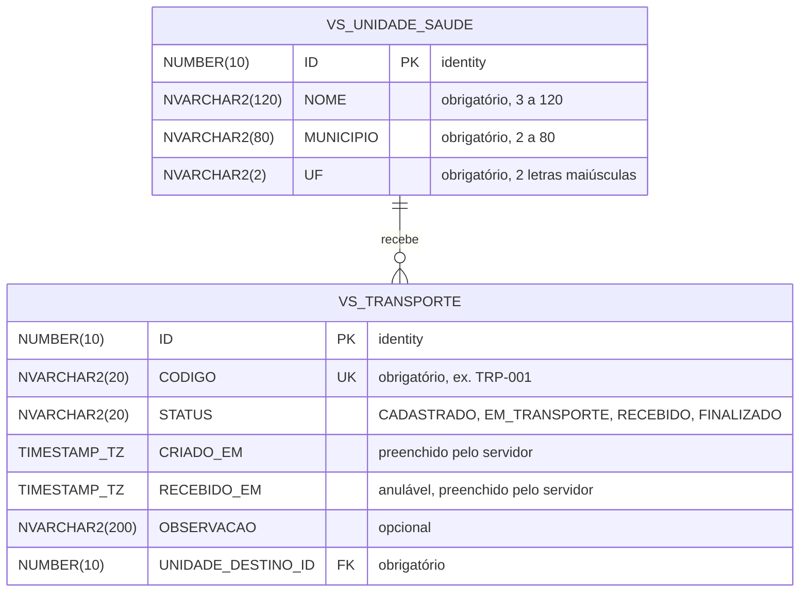

# VaciSmart — API .NET (Unidades de Saúde e Transportes)

> **Global Solution FIAP 2026/2 — CitizenTech**
> Disciplina: **Advanced Business Development with .NET**
> ASP.NET Core 8 (Web API com controllers) · Entity Framework Core · Oracle FIAP · Migrations

## Integrantes

| Nome completo | RM | Turma |
|---|---|---|
| Caike Roberto de Souza Hollo | RM568104 | 2TDSPA |
| Gabriel Deotti Zanatta | RM567258 | 2TDSPA |
| Gianluca K. Araujo | RM566765 | 2TDSPA |
| Giovanni Sacristan | RM567548 | 2TDSPA |
| Murilo Massini | RM567383 | 2TDSPA |

**Vídeo de demonstração (até 5 min):** _COLAR_LINK_DO_YOUTUBE_

---

## 1. A solução

O **VaciSmart** é a CitizenTech do grupo: um ecossistema de imunização que monitora a
**cadeia de frio** das vacinas durante o transporte e informa ao cidadão, de forma simples,
quando uma vacina está disponível na unidade de saúde.

- **Cidadão beneficiado:** quem depende da sala de vacinação da sua unidade de saúde.
- **Problema:** uma vacina que sai da faixa de temperatura no transporte precisa ser
  detectada e avaliada antes de chegar ao braço de alguém — e o cidadão precisa saber, sem
  promessa falsa, se a vacina está disponível no posto.
- **ODS:** 3 (Saúde e Bem-Estar), com conexão ao 9 e ao 10.

### O que esta API faz dentro do VaciSmart

Esta API é o **módulo administrativo** da solução: cadastra as **unidades de saúde** e as
**remessas (transportes)** de vacinas destinadas a cada unidade. É a base cadastral sobre a
qual o resto do ecossistema trabalha.

| Entrega do grupo | Papel | Relação com esta API |
|---|---|---|
| **.NET (este repositório)** | Cadastro de unidades e transportes, com Oracle | — |
| Java Advanced | API principal: leituras térmicas, bloqueio de lote, disponibilidade | Mesmo domínio e mesmos nomes de status (`CADASTRADO`, `EM_TRANSPORTE`, `RECEBIDO`, `FINALIZADO`) |
| Mobile (Flutter) | App do cidadão e do funcionário | Consome a API Java; as telas de remessa usam os mesmos conceitos cadastrados aqui |
| DevOps | VM Azure + Docker Compose | O grupo escolheu containerizar a API Java; esta API usa o Oracle da FIAP |

> Decisão de escopo do grupo: **não há GPS, rota ou localização** de transporte em nenhum
> módulo. O transporte é acompanhado por **status e horários de eventos**.

---

## 2. Modelo de dados

Duas entidades com relacionamento **1:N**: uma unidade de saúde recebe vários transportes;
cada transporte tem exatamente uma unidade de destino.



| Classe C# | Tabela Oracle | Observação |
|---|---|---|
| `UnidadeSaude` | `VS_UNIDADE_SAUDE` | Lado **1**. Possui a lista `Transportes`. |
| `Transporte` | `VS_TRANSPORTE` | Lado **N**. `UnidadeDestinoId` é a FK (`FK_VS_TRANSPORTE_UNIDADE`). |

Regras do modelo:

- A FK usa `DeleteBehavior.Restrict`: **não é possível excluir uma unidade que ainda tem
  transportes** (a API responde `409`).
- `CODIGO` tem índice único (`UK_VS_TRANSPORTE_CODIGO`).
- `CRIADO_EM` e `RECEBIDO_EM` são controlados pelo servidor. `RECEBIDO_EM` é preenchido
  quando o status passa a `RECEBIDO` ou `FINALIZADO`.

### Migrations versionadas

| Migration | O que faz |
|---|---|
| `20261111211302_CriacaoInicial` | Cria `VS_UNIDADE_SAUDE`, `VS_TRANSPORTE`, PKs, FK e índices |
| `20261111211315_AdicionaObservacaoTransporte` | Adiciona a coluna opcional `OBSERVACAO` em `VS_TRANSPORTE` |

Todas as tabelas são criadas **somente** pelas Migrations (`dotnet ef database update`).

---

## 3. Estrutura do projeto

```
.
├── Controllers/
│   ├── UnidadesController.cs      # CRUD de unidades + GET /unidades/{id}/transportes
│   └── TransportesController.cs   # CRUD de transportes
├── Data/
│   └── AppDbContext.cs            # DbContext, relacionamento 1:N, índices
├── Models/
│   ├── UnidadeSaude.cs            # entidade + validações
│   ├── Transporte.cs              # entidade + validações
│   └── StatusTransporte.cs        # status permitidos
├── Migrations/                    # geradas pelo EF Core (versionadas)
├── scripts/consultas-oracle.sql   # SELECTs para conferir as tabelas no Oracle
├── VaciSmart.Api.http             # requisições prontas para testar
├── Program.cs
└── VaciSmart.Api.csproj
```

---

## 4. Como executar

### 4.1 Pré-requisitos

- **.NET SDK 8** (`dotnet --version` deve mostrar `8.0.x`)
  - macOS com Homebrew: `brew install --cask dotnet-sdk@8`
  - Windows/Linux/macOS sem Homebrew: instalador em <https://dotnet.microsoft.com/download/dotnet/8.0>
- Acesso ao **Oracle da FIAP** (`oracle.fiap.com.br`, porta `1521`) com o seu usuário (RM) e senha.

### 4.2 Passo a passo

```bash
# 1) Clonar e entrar na pasta (o projeto fica na raiz do repositório)
git clone URL_DO_REPOSITORIO
cd NOME_DO_REPOSITORIO

# 2) Restaurar a ferramenta dotnet-ef (versão fixada em .config/dotnet-tools.json)
dotnet tool restore

# 3) Configurar a connection string FORA do repositório (user-secrets)
dotnet user-secrets set "ConnectionStrings:OracleFiap" "User Id=SEU_RM;Password=SUA_SENHA;Data Source=oracle.fiap.com.br:1521/ORCL"

# 4) Aplicar as Migrations no Oracle (cria as tabelas)
dotnet ef database update

# 5) Subir a API
dotnet run
```

A API sobe em **<http://localhost:5080>** e o Swagger abre em
**<http://localhost:5080/swagger>**.

> **A senha do Oracle nunca entra no repositório.** O `appsettings.json` tem a chave
> `ConnectionStrings:OracleFiap` vazia; o valor real fica no *user-secrets* da sua máquina.
> Alternativa ao user-secrets: variável de ambiente `ConnectionStrings__OracleFiap`.
>
> ```bash
> # macOS / Linux
> export ConnectionStrings__OracleFiap="User Id=SEU_RM;Password=SUA_SENHA;Data Source=oracle.fiap.com.br:1521/ORCL"
> # Windows (PowerShell)
> $env:ConnectionStrings__OracleFiap = "User Id=SEU_RM;Password=SUA_SENHA;Data Source=oracle.fiap.com.br:1521/ORCL"
> ```

Se a connection string não estiver configurada, a aplicação para na inicialização com uma
mensagem dizendo exatamente o comando que falta.

### 4.3 Problemas comuns

| Sintoma | Causa provável | O que fazer |
|---|---|---|
| `You must install or update .NET` citando `Microsoft.AspNetCore.App` 8.0 | Só há SDK mais novo (9 ou 10) instalado, sem o runtime do .NET 8 | Instalar o .NET 8 ao lado do que já existe (`brew install --cask dotnet-sdk@8` ou instalador oficial) e conferir com `dotnet --list-runtimes` |
| `Connection string 'OracleFiap' não configurada` | Passo 3 não foi feito | Rodar o `dotnet user-secrets set ...` |
| `ORA-01017` | Usuário ou senha incorretos | Conferir RM e senha do Oracle FIAP |
| `ORA-12514` / `ORA-12505` | Nome do serviço/SID diferente | Trocar o `Data Source` por `(DESCRIPTION=(ADDRESS=(PROTOCOL=TCP)(HOST=oracle.fiap.com.br)(PORT=1521))(CONNECT_DATA=(SID=ORCL)))` |
| Tempo esgotado ao conectar | Rede bloqueando a porta 1521 | Testar em outra rede (ex.: rede da FIAP ou 4G) |
| `ORA-00955` no `database update` | Já existem tabelas `VS_...` criadas fora das Migrations | Apagar as tabelas antigas e rodar o `database update` de novo |

---

## 5. Endpoints

Base: `http://localhost:5080/api`

### Unidades de saúde

| Método | Rota | Sucesso | Erros tratados |
|---|---|---|---|
| GET | `/unidades` | `200` lista | — |
| GET | `/unidades/{id}` | `200` | `404` |
| GET | `/unidades/{id}/transportes` | `200` lista de transportes da unidade (1:N) | `404` |
| POST | `/unidades` | `201` + header `Location` | `400` |
| PUT | `/unidades/{id}` | `204` | `400`, `404` |
| DELETE | `/unidades/{id}` | `204` | `404`, `409` (ainda tem transportes) |

### Transportes

| Método | Rota | Sucesso | Erros tratados |
|---|---|---|---|
| GET | `/transportes` | `200` lista | — |
| GET | `/transportes/{id}` | `200` | `404` |
| POST | `/transportes` | `201` + header `Location` | `400`, `409` (código repetido) |
| PUT | `/transportes/{id}` | `204` | `400`, `404`, `409` |
| DELETE | `/transportes/{id}` | `204` | `404` |

### Corpo das requisições

```jsonc
// POST/PUT /api/unidades
{ "nome": "Unidade Demonstrativa 01", "municipio": "São Paulo", "uf": "SP" }

// POST/PUT /api/transportes
{
  "codigo": "TRP-001",          // obrigatório, 3 a 20, maiúsculas/números/hífen, único
  "unidadeDestinoId": 1,        // obrigatório, precisa existir
  "status": "EM_TRANSPORTE",    // opcional no POST (padrão CADASTRADO)
  "observacao": "texto livre"   // opcional, até 200
}
```

### Validação e tratamento de erros

Todos os erros voltam em **JSON** (`application/problem+json`, padrão *ProblemDetails*).

**`400` — dado inválido** (`POST /api/unidades` com nome vazio e UF minúscula):

```json
{
  "type": "https://tools.ietf.org/html/rfc9110#section-15.5.1",
  "title": "Dados inválidos. Verifique os campos informados.",
  "status": 400,
  "errors": {
    "Uf": ["A UF deve ter exatamente 2 letras maiúsculas (ex.: SP)."],
    "Nome": ["O nome da unidade é obrigatório.", "O nome deve ter entre 3 e 120 caracteres."]
  }
}
```

**`404` — id inexistente** (`GET /api/unidades/999`):

```json
{
  "type": "https://tools.ietf.org/html/rfc9110#section-15.5.5",
  "title": "Unidade de saúde não encontrada",
  "status": 404,
  "detail": "Não existe unidade de saúde com id 999."
}
```

Também devolvem `400`: JSON malformado, status fora da lista, código de transporte fora do
padrão, `unidadeDestinoId` que não existe e `id` do corpo diferente do `id` da rota.

---

## 6. Como testar

### Opção A — arquivo `VaciSmart.Api.http` (recomendado)

Abra `VaciSmart.Api.http` no Visual Studio, Rider ou VS Code (extensão *REST Client*) e
execute as requisições **na ordem**. O arquivo cobre o CRUD completo das duas entidades, o
relacionamento 1:N e todos os erros tratados (400, 404 e 409), com o status esperado
escrito em cada uma.

### Opção B — Swagger

Com a API rodando, abra <http://localhost:5080/swagger>.

### Opção C — curl

```bash
BASE=http://localhost:5080/api

# CRUD de unidade
curl -i -X POST $BASE/unidades -H "Content-Type: application/json" \
  -d '{"nome":"Unidade Demonstrativa 01","municipio":"São Paulo","uf":"SP"}'      # 201
curl -i $BASE/unidades                                                             # 200
curl -i $BASE/unidades/1                                                           # 200
curl -i -X PUT $BASE/unidades/1 -H "Content-Type: application/json" \
  -d '{"nome":"Unidade Demonstrativa 01 - Centro","municipio":"São Paulo","uf":"SP"}'  # 204

# CRUD de transporte (1:N com a unidade 1)
curl -i -X POST $BASE/transportes -H "Content-Type: application/json" \
  -d '{"codigo":"TRP-001","unidadeDestinoId":1,"status":"EM_TRANSPORTE"}'          # 201
curl -i $BASE/unidades/1/transportes                                               # 200
curl -i -X PUT $BASE/transportes/1 -H "Content-Type: application/json" \
  -d '{"codigo":"TRP-001","unidadeDestinoId":1,"status":"RECEBIDO"}'               # 204

# Erros tratados
curl -i -X POST $BASE/unidades -H "Content-Type: application/json" \
  -d '{"nome":"","municipio":"São Paulo","uf":"sp"}'                                # 400
curl -i $BASE/unidades/999                                                         # 404
curl -i -X DELETE $BASE/unidades/1                                                 # 409 (tem transporte)

# Exclusão
curl -i -X DELETE $BASE/transportes/1                                              # 204
curl -i -X DELETE $BASE/unidades/1                                                 # 204
```

### Conferindo no Oracle

No SQL Developer, conectado com o mesmo usuário, rode `scripts/consultas-oracle.sql`. As
consultas mostram as tabelas criadas pelas Migrations, a FK e os dados gravados pela API:

```sql
SELECT "MigrationId" FROM "__EFMigrationsHistory";
SELECT * FROM VS_UNIDADE_SAUDE;
SELECT t.CODIGO, t.STATUS, u.NOME AS UNIDADE_DESTINO
  FROM VS_TRANSPORTE t JOIN VS_UNIDADE_SAUDE u ON u.ID = t.UNIDADE_DESTINO_ID;
```

---

## 7. Tecnologias

| Item | Versão |
|---|---|
| .NET / ASP.NET Core | 8.0 |
| Entity Framework Core (Design/Tools) | 8.0.34 |
| Oracle.EntityFrameworkCore | 8.23.26400 |
| Banco | Oracle FIAP (`oracle.fiap.com.br:1521`) |
| Swashbuckle (Swagger) | 6.6.2 — apenas para facilitar os testes |

---

## 8. Uso de IA generativa

_Ajustar este texto para refletir o uso real da equipe antes de entregar._

- **Ferramenta:** Claude (Anthropic).
- **Para quê:** apoio na estruturação do projeto (entidades, DbContext e controllers), na
  escrita deste README e na montagem do roteiro de testes.
- **Revisão humana:** o código foi lido, executado e testado pela equipe contra o Oracle,
  e todos os integrantes sabem explicar o fluxo de uma requisição e o modelo de dados.
